# HCPBridgeMqtt — WLED automation, MQTT & Home Assistant

**Version 2.0.2** · ESP32 / HCP2 · Local web UI · Deutsch / English

Control a Hörmann garage door, automate WLED presets and inspect bus activity from the ESP32's web interface.

[Deutsche Anleitung](HCPBridgeESP32/README-WLED-DE.md) · [Changelog](HCPBridgeESP32/CHANGELOG.md) · [WebUI screenshots](#screenshots)

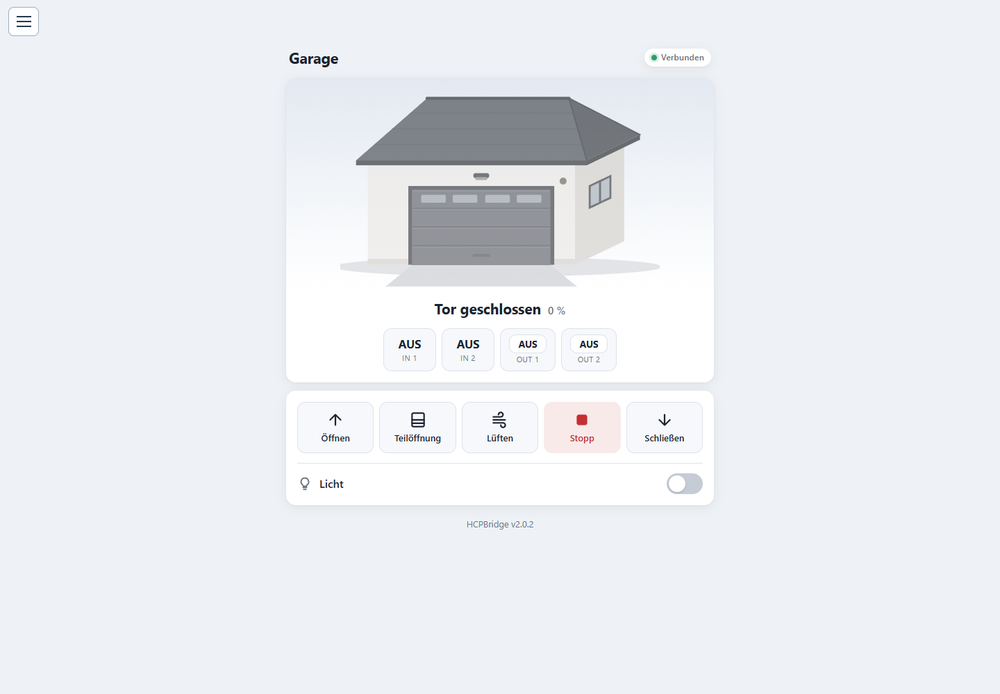

**Emulates Hörmann UAP1-HCP (HCP2) using an ESP32 + RS485 converter and exposes garage door controls via MQTT and a web UI.**

---

## Table of Contents
- [Quick Start](#quick-start)
- [Compatibility](#compatibility)
- [Features](#features)
- [Installation](#installation)
- [Build with PlatformIO](#build-with-platformio)
- [Web Interface](#web-interface)
- [WLED automation](#wled-automation)
- [Block-based flow editor](#block-based-flow-editor)
- [Typed variables and preset input](#typed-variables-and-preset-input)
- [Bus log and serial diagnostics](#bus-log-and-serial-diagnostics)
- [Languages](#languages)
- [Factory Reset & Sensor Recovery](#factory-reset--sensor-recovery)
- [MQTT & Home Assistant](#mqtt--home-assistant)
- [Configuration](#configuration)
- [Sensors (optional)](#sensors-optional)
- [Digital Inputs & Outputs (optional)](#digital-inputs--outputs-optional)
- [Wi-Fi in multi-AP networks](#wi-fi-in-multi-ap-networks)
- [Ventilation (vent) position](#ventilation-vent-position)
- [Troubleshooting](#troubleshooting)
- [Development & Contributing](#development--contributing)
- [License](#license)
- [Screenshots](#screenshots)
- [More docs](#more-docs)

---

## Quick Start
1. Flash the firmware to an ESP32 (see [Build with PlatformIO](#build-with-platformio)).
2. Connect ESP32 TX/RX to an RS485 converter and wire to the HCP bus.
3. Power on the motor control board and run a BUS scan (see **Installation**).
4. Connect to the device hotspot or your Wi-Fi and open the web interface (details below).
5. Open the **three-bar menu at the top left** to configure Wi-Fi, MQTT, sensors and I/O.
6. For lighting automation, configure the WLED IPv4 address, create a flow and save it. Flows execute on the bridge with the browser closed.

Configuration and flow definitions are stored on the ESP32. Diagnostic logs are RAM buffers and are lost on restart.

If you just want to test: connect to hotspot `HCPBRIDGE` / password `gifford47`, open the web UI and set your MQTT broker.

---

## Build with PlatformIO

Open [`HCPBridgeESP32`](HCPBridgeESP32) as the PlatformIO project, then select the environment that matches your board.

| Environment | Board |
|---|---|
| `esp32` | NodeMCU-32S / generic ESP32 configuration |
| `HCP_Giffordv1` | HCP Gifford v1 |
| `HCP_Giffordv2` | ESP32-S3 DevKitC configuration |
| `HCP_Giffordv3` | ESP32-based HCP Gifford v3 |
| `m5stack-stamps3` | M5Stack StampS3 |
| `m5stack-atom-lite` | M5Stack Atom Lite |

```sh
cd HCPBridgeESP32
pio run -e esp32
pio run -e esp32 -t upload
```

Replace `esp32` with your environment. Pin defaults and hardware options depend on that selection. Web pages, scripts and translation JSON files are embedded during the build; no separate filesystem upload is required.

## Compatibility
| Supported motors (UAP1-HCP / HCP2-Bus / Modbus) |
|---|
| SupraMatic E/P **Serie 4** |
| ProMatic **Serie 4** |
| [Rollmatic v2](https://github.com/Gifford47/HCPBridgeMqtt/blob/master/docs/rollmatic_v2.md) |

> **Not compatible** with E**3** series motors (different protocol / layout). For older HCP1 hardware see other projects: [hgdo](https://github.com/steff393/hgdo), [hoermann_door](https://github.com/stephan192/hoermann_door), [hormann-hcp](https://github.com/raintonr/hormann-hcp).

---

## Features
- Read door status: open/closed/position, light on/off
- Control: open, close, stop, light toggle, set position (half/vent/custom)
- MQTT with Home Assistant Auto Discovery
- Web Interface for configuration & control
- OTA Updates
- First-use hotspot (for out-of-the-box Wi-Fi setup)
- Board-specific ESP32 and ESP32-S3 environments listed above
- Optional external sensors (DS18x20, BME280, DHT22, HC-SR04, HC-SR501, MQ4)
- Optional digital inputs (wall button) and outputs (relay module) on the prebuilt PCBs
- Efficient MQTT traffic (only publish on state change)
- Support multiple HCP Bridges for several doors
- WLED HTTP preset calls and JSON state access
- Drag-and-drop flow editor with triggers, conditions, delays and connected blocks
- Typed `string`, `int` and `bool` variables, live values and optional persistence
- Integer variable input for the WLED preset block
- WLED `/win` XML fields mapped individually to variables, including repeated RGB fields
- Separate settings overlays opened from a shared three-bar menu
- German and English UI with device-persisted language selection
- Bus and serial diagnostic viewers with live updates and JSON download

---

## Installation

### Hardware
1. Connect the provided RJ12 cable
See also: [Getting started prebuild PCBs](https://github.com/Gifford47/HCPBridgeMqtt/blob/master/docs/getting_started_prebuild_pcbs.md)

### BUS Scan / First Run
- **Old hardware**: trigger BUS scan by flipping the last DIP switch (ON → OFF). Note: BUS power (+24V) may be removed when no devices detected — you can "jump start" using +24V from motor connectors if necessary.
- **New hardware**: BUS scan via the LC display in menu `37`. See:
  - [Supramatic 4 Busscan guide EN](https://github.com/Gifford47/HCPBridgeMqtt/blob/master/docs/bus_scan_EN.md)
  - [Supramatic 4 Busscan guide DE](https://github.com/Gifford47/HCPBridgeMqtt/blob/master/docs/bus_scan_DE.md)

---

## Web Interface
To access the web interface, first connect to the device’s automatic Wi-Fi hotspot.
By default, the hotspot is named **`HCPBRIDGE`** and secured with the password **`gifford47`**.

Once connected, open a web browser and go to:
**http://[deviceip]**
(you can also try **http://192.168.4.1** if you are connected directly to the hotspot).

When the login screen appears, use the following default credentials:
- **Username:** `admin`
- **Password:** *(leave empty)*

After logging in, you will see the main control panel of the device.

### OTA Update Access
For performing OTA (Over-The-Air) updates, authentication uses a different set of credentials:
- **Username:** `admin`
- **Password:** `admin`

### Navigation and settings overlays

The **three-bar menu at the top left** provides access to Wi-Fi/MQTT/device settings, sensors, inputs and outputs, expert settings, WLED connection, the flow editor, variables, bus log, serial diagnostics, language and system/firmware information.

Configuration panels open as separate overlays. They are no longer appended below the garage overview. Wi-Fi/MQTT, sensor, I/O and expert forms retain their **Save & Restart** buttons. WLED connection and flow changes are applied together with **Save** in the editor, without restarting the bridge.

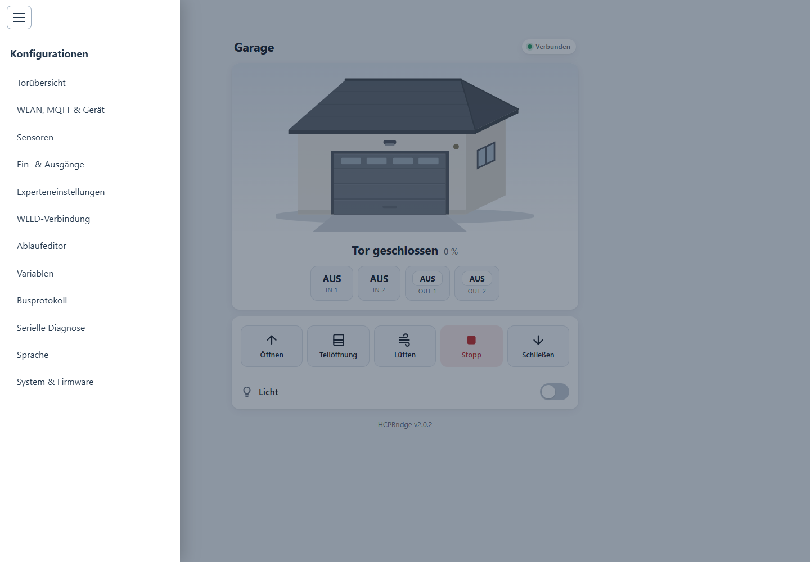

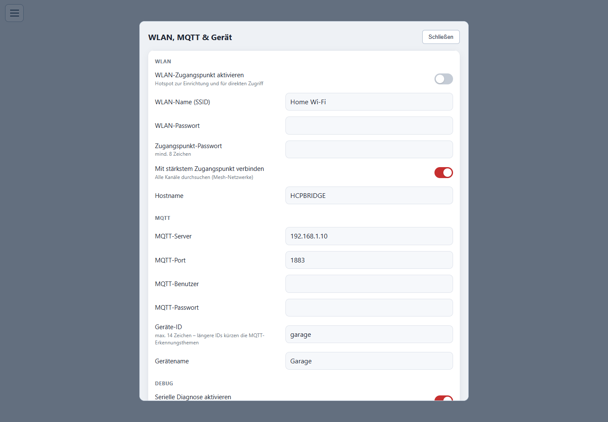

---

## WLED automation

1. Open **WLED connection / WLED-Verbindung** in the menu.
2. Enter the IPv4 address of the separate WLED controller.
3. Enable the flow engine and close the settings overlay.
4. Open the flow editor, configure triggers and actions, then click **Save**.

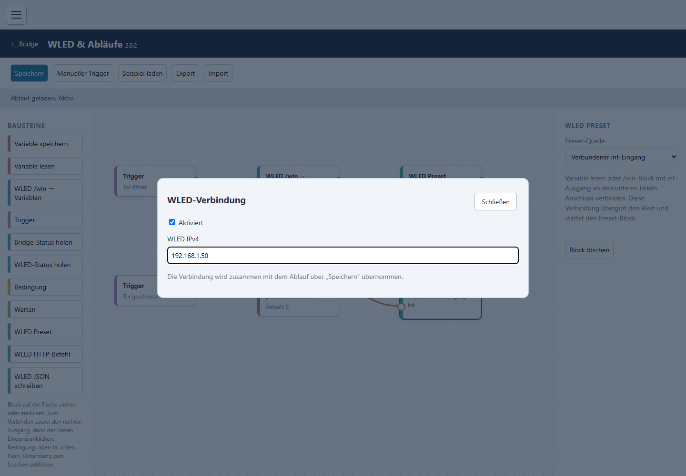

The bridge makes local HTTP requests to WLED. Presets must already exist on the WLED device.

| Block | Request / purpose |
|---|---|
| WLED preset | `GET http://<WLED-IP>/win&PL=<1–250>` |
| WLED HTTP command | Parameters such as `T=1&A=128` appended to `/win&` |
| Read WLED status | `GET /json/state`, available to later blocks under `wled` |
| Write WLED JSON | JSON object sent with `POST /json/state` |
| WLED /win → variables | `GET /win`, XML fields converted into selected target variables |

Use **PL** to apply a preset. **PS** in an HTTP write command saves a preset instead. The HTTP-command block accepts parameters only, without an IP address, `/win`, or a leading `&`.

### Read individual WLED values

In **WLED /win → variables**, add a mapping for each XML field, its zero-based index and its target variable. **Show current WLED fields** reads the saved WLED address and displays the values actually returned by that device.

| XML field | Index | Example variable type |
|---|---|---|
| `ps` | 0 | `int` — current preset |
| `ac` | 0 | `int` — current output brightness |
| `cl` | 0 / 1 / 2 | `int` — primary red / green / blue |
| `cs` | 0 / 1 / 2 | `int` — secondary red / green / blue |
| `nl` | 0 | `bool` — nightlight active |
| `ds` | 0 | `string` — device name |

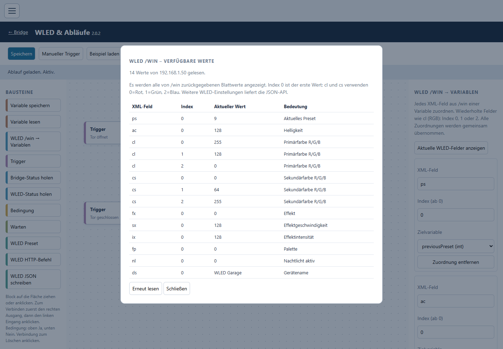

Mappings are validated before their variables are updated together. A missing field or incompatible type stops that block without partially updating its targets. Choose **Output value** to select the variable passed to the next block.

`/win` exposes WLED's XML status fields, not every segment or configuration option. Use the JSON read block and a variable-write block for other available JSON values. The XML response is limited to 8192 bytes, with up to 24 mappings per block. See the official [WLED HTTP API](https://kno.wled.ge/interfaces/http-api/) and [JSON API](https://kno.wled.ge/interfaces/json-api/).

---

## Block-based flow editor

Open **Flow editor / Ablaufeditor** from the menu. Drag blocks from the left palette onto the canvas or click a palette item to add it. Drag a block to move it and select it to edit its properties on the right.

To connect blocks, click the right output and then a left input. For conditions, the upper output is **Yes**, the lower output is **No**. Click a wire to remove it; Escape cancels an unfinished connection.

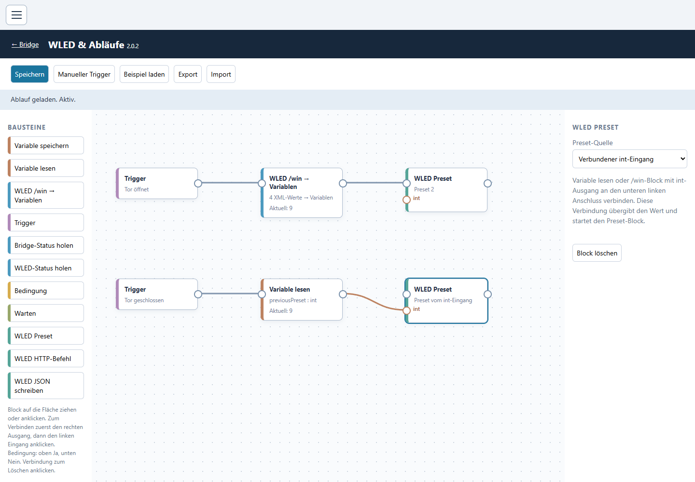

Available blocks:

- **Trigger:** door state changes, door light on/off, startup, time interval or manual trigger.
- **Read bridge status:** door, light, configured sensors and I/O values under `bridge`.
- **Read WLED status**, **WLED /win → variables**, **WLED preset**, **WLED HTTP command** and **Write WLED JSON**.
- **Condition:** equality, inequality, greater-than and less-than comparisons.
- **Wait:** schedule the next step without blocking the bus task.
- **Read variable** and **Save variable**.

For example:

```text
Door opening → /win: save current ps → activate preset 2
Door closed  → read previousPreset  → preset block's int input
```

The second connection passes the integer value **and starts the preset block**. Connect the closed trigger to the variable-read block first, rather than directly to the preset's normal input.

**Save** applies the flow to the bridge. **Manual trigger** runs only saved triggers whose event is Manual; it does not simulate a door movement. **Export** and **Import** exchange flow definitions as JSON. A flow runs on the ESP32 without an open browser.

Importable examples:

- [Basic door-to-preset flow](HCPBridgeESP32/examples/tor-wled.json)
- [Save and restore a preset with typed variables](HCPBridgeESP32/examples/preset-sichern-wiederherstellen.json)

Maximums: **24 blocks, 48 connections, 24 variables and 16 queued steps**. Cycles are rejected; use a timer trigger for repetition. Timer intervals start at one second, and delays are limited to one hour. Incoming branches execute independently rather than waiting for a join. Saving replaces the active graph and clears waiting steps.

---

## Typed variables and preset input

Open **Variables / Variablen** in the menu. Define a name, type, initial value and whether the value should persist across restarts.

| Type | Values |
|---|---|
| `string` | Text up to 256 UTF-8 bytes |
| `int` | Signed 32-bit integer |
| `bool` | `true` / `false`, or `1` / `0` |

Names start with a letter or underscore and can contain letters, digits and underscores, up to 24 characters. Variables are global to the saved flow. **Save variable** accepts a literal or a field path such as `bridge.currentPosition`, `wled.ps`, or `vars.previousPreset`. Conditions can read `vars.<name>` directly.

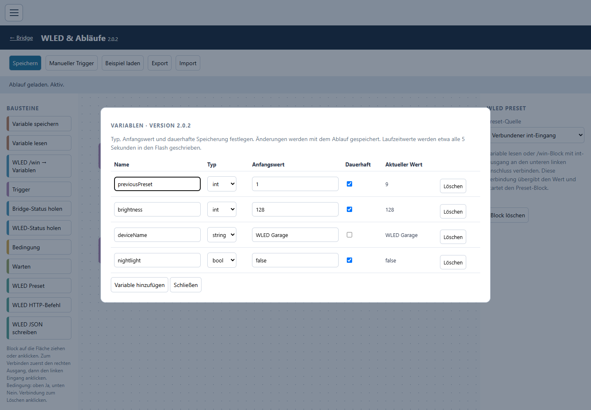

Variable blocks display their current runtime value on the canvas. A dash is shown until the runtime status is available.

The preset block supports a fixed number or the additional **brown int input**. Connect an integer output from a variable or `/win` block to that port. The block checks the supplied number at runtime and accepts only presets **1–250**; an unset variable containing 0 cannot restore a preset.

Persistent values are written together approximately every five seconds when they change. Changes since the last write can be lost on sudden power failure. Nonpersistent variables use their initial values after restart or when a new flow is applied. Existing persistent values are preserved while name and type remain unchanged. Flow exports contain definitions and initial values, not current flash-stored runtime values.

---

## Bus log and serial diagnostics

### Bus log

Open **Bus log / Busprotokoll** to inspect processed Modbus activity: time since startup, register, previous/new raw values, interpreted position and target, state and MQTT queue events.

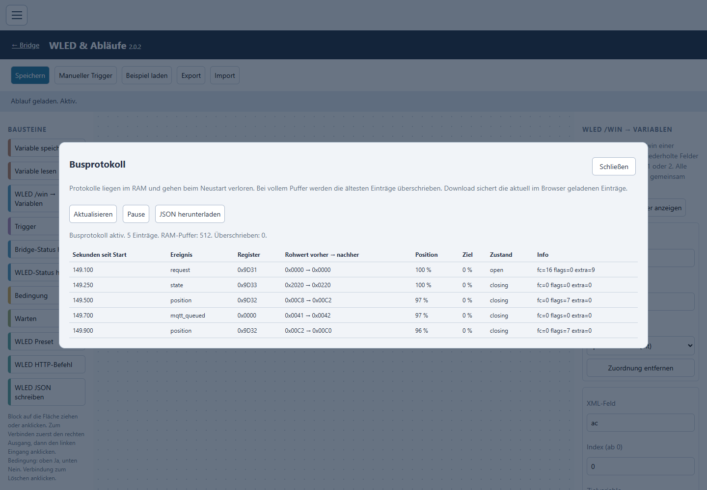

- **512 entries** in a RAM ring buffer; old entries are overwritten when full.
- Position register `0x9D32`, state register `0x9D33`, light and other changed status registers are recorded.
- Unknown state codes are kept as `unknown_state` events.
- `mqtt_queued` means publication was queued; it is not a receipt confirmation from Home Assistant.
- **Pause**, **Refresh** and **Download JSON** operate on the viewer. The browser retains up to 1000 loaded entries and shows the latest 250 in the table.
- API: `GET /api/bus/log?after=<sequence>`, paged at up to 32 entries per response.

To investigate missing opening updates, open the log before moving the door and download an opening trace and a closing trace. The log contains processed register callbacks; invalid UART/CRC frames are not included. Do not infer movement or position from a successful HTTP command response alone.

### Serial diagnostics

Enable **serial debug** under Wi-Fi/MQTT/device settings, then **Save & Restart**. Open **Serial diagnostics / Serielle Diagnose** in the menu to read the output live.

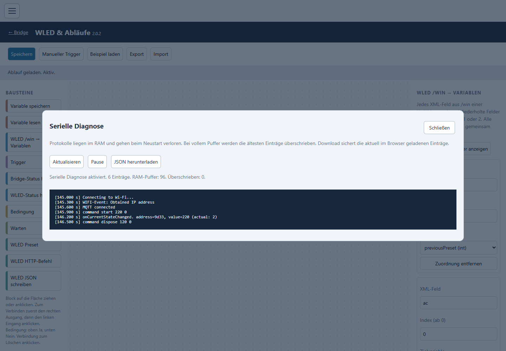

The viewer captures `DBG_PRINT`, `DBG_PRINTLN`, `DBG_PRINTF` and emitted `ESP_LOG` messages while continuing USB/Serial output. It stores **96 completed lines**, up to **160 characters per line**; longer lines are marked as truncated. Updates, pause and JSON download are available in the browser.

API: `GET /api/debug/serial?after=<sequence>`. The viewer reports when serial debugging is disabled. It displays diagnostic output; it does not provide a remote serial command terminal.

**Both logs are held in RAM and cleared on restart or power loss.** Download useful traces before restarting. They use the existing Web UI authentication and do not write each bus event to flash.

---

## Languages

Choose **Language / Sprache** from the menu and select **Deutsch** or **English**. The bridge saves the choice in nonvolatile storage and reloads it after restart, including when opening the UI from another browser.

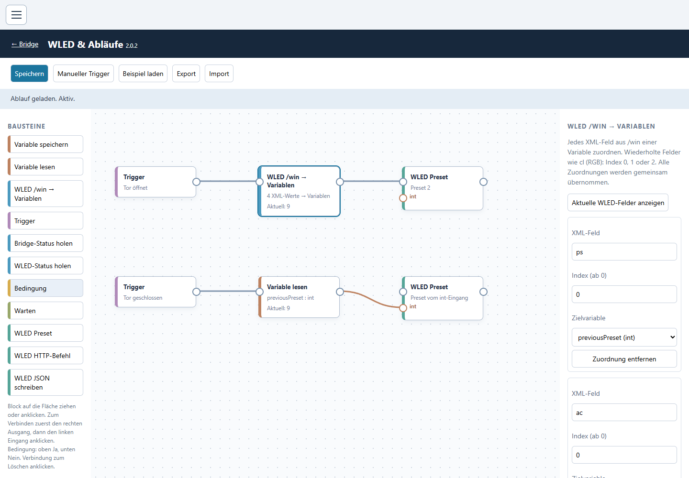

Translation sources are separate JSON files:

- [German — de.json](HCPBridgeESP32/WebUI/webpage/i18n/de.json)
- [English — en.json](HCPBridgeESP32/WebUI/webpage/i18n/en.json)

After editing a translation, rebuild the firmware so the embedded language assets are updated. A factory reset restores the default language, German.

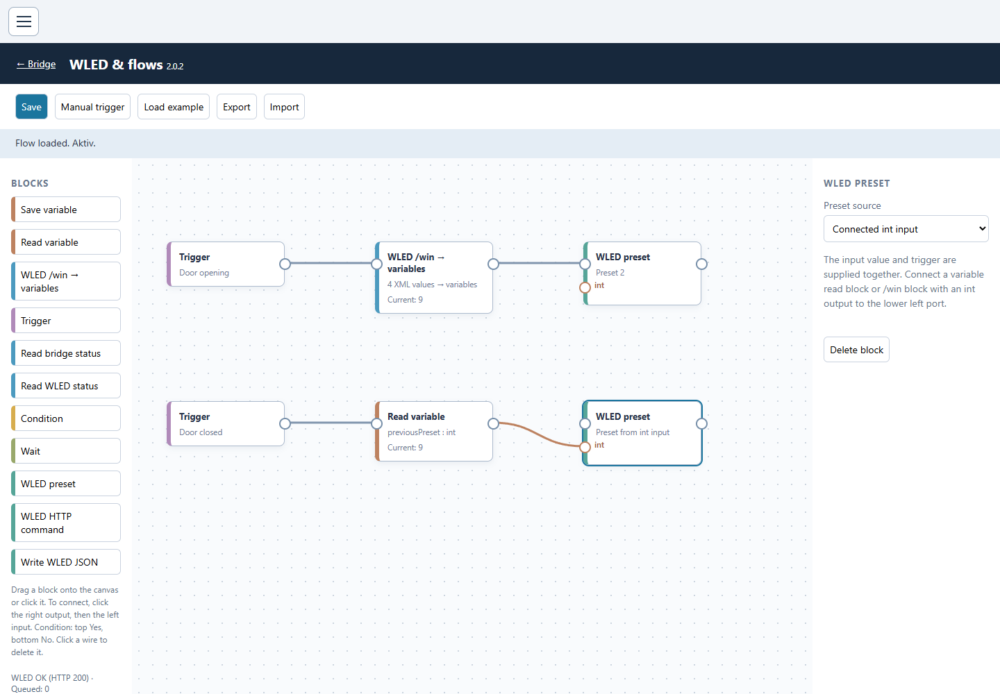

---

## Factory Reset & Sensor Recovery
The Boot button (GPIO 0) supports two reset levels:

| Presses (within 6s) | Action |
|---|---|
| **3x** | Disable all sensors and restart (sensor recovery) |
| **5x** | Full factory reset (clear all preferences) |

**Sensor recovery (3x press):**
If a faulty sensor causes boot problems, press the button 3 times to disable all sensors. The device will restart normally and you can fix the sensor configuration in the Web UI.

**Automatic crash recovery:**
If a sensor causes a crash (panic/watchdog), the firmware detects this on the next boot via `esp_reset_reason()` and automatically disables all sensors.

**Full factory reset (5x press):**
Clears Wi-Fi, MQTT, sensor and I/O configuration, WLED flow definitions, stored variables and the language choice. The device restarts with its default hotspot. RAM diagnostic history is also lost on restart.

---

## MQTT & Home Assistant

All topics live under `hormann/<device_id>/`. The **Device ID** is set in the basic configuration and is limited to **14 characters** — longer IDs would overflow the discovery topic buffers.

**State topics (published by the bridge):**

| Topic | Content |
|---|---|
| `availability` | `online` / `offline` (last will) |
| `state` | JSON: `doorstate`, `doorposition`, `detailedState`, `lamp`, `vent`, `half`, `valid` |
| `position` | door position as an integer 0–100 |
| `sensor` | JSON with the enabled sensors: `temp`, `hum`, `pres`, `dist`, `free`, `motion`, `gas`, `gas_alarm` |
| `io` | JSON with the enabled digital channels: `in1`, `in2`, `out1`, `out2` |
| `debug` | JSON: `restart_reason`, `debug`, plus `sensor_error` / `io_error` when something failed |

**Command topics (subscribed by the bridge):**

| Topic | Payloads |
|---|---|
| `command/door` | `open`, `close`, `stop`, `step` |
| `command/lamp` | `true`, `false`, anything else toggles |
| `command/vent` | `venting` |
| `command/half` | `half` |
| `command/step` | `step` (impulse: open ↔ stop ↔ close) |
| `command/set_position` | `0` … `100` |
| `command/out1`, `command/out2` | `true`, `false`, anything else toggles |

Example:

```bash
mosquitto_pub -h broker -t 'hormann/hcpbridge/command/door' -m 'open'
mosquitto_pub -h broker -t 'hormann/hcpbridge/command/set_position' -m '50'
mosquitto_sub -h broker -t 'hormann/hcpbridge/#' -v
```

### Home Assistant (MQTT Auto Discovery)
Discovery messages are published **once at boot** (not on every reconnect) and adapt to what is actually enabled:

- `cover` — the garage door, with position support
- `switch` — light, vent, half position, and each enabled digital output
- `button` — impulse / toggle
- `sensor` — door status, detailed status, position, plus temperature / humidity / pressure / distance / gas for the enabled sensors, and the debug entities
- `binary_sensor` — light, parking space, motion, gas alarm, and each enabled digital input

Entities of sensors or I/O channels you switch off are removed again by clearing their retained discovery topic. No manual `configuration.yaml` entries are needed.

> If you change the **Device ID**, Home Assistant will create a new set of entities — the old ones stay behind as unavailable and have to be deleted manually.

---

## Configuration
Everything is configured in the Web UI and stored in the ESP32's flash — there is no config file to edit and **no separate firmware build per feature**. The compile-time values in `src/configuration.h` only provide the defaults for the very first boot.

The three-bar menu opens separate settings overlays. The following four forms each retain their own *Save & Restart* button:

| Form | Contains |
|---|---|
| **Basic Configuration** | Wi-Fi (hotspot or client, "connect to strongest AP"), MQTT broker/credentials, Device ID (**max. 14 characters**) and device name, serial debug, web password |
| **Sensor Configuration** | Which sensors are active, their GPIOs, the polling interval and the publish thresholds |
| **I/O Configuration** | The In1/In2/Out1/Out2 channels: enable, GPIO, pull mode, inversion, local action, name |
| **Expert Configuration** | RS485 GPIOs and the entity names used for MQTT discovery |

**System & firmware** opens a separate overlay and shows firmware version, build environment, IP, Wi-Fi signal strength, free memory, reset reason and the state of every sensor and I/O channel, and links to the OTA update and factory reset pages.

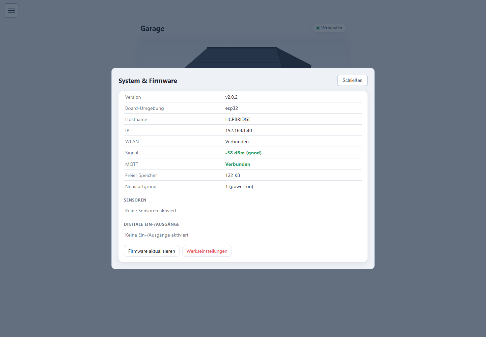

---

## Sensors (optional)
Sensors are enabled via the Web UI under **Sensor Configuration** — one checkbox per sensor, with its GPIOs and thresholds next to it. If an enabled sensor is not connected or fails to initialize, the ESP will continue booting normally and report the error via the debug MQTT entity.

> **There is only one firmware per board any more.** Older releases shipped separate `…a` (without sensors) and `…b` (with sensors) binaries — those are gone. Flash `esp32-vX.Y.Z.bin`, `HCP_Giffordv2-vX.Y.Z.bin` or `HCP_Giffordv3-vX.Y.Z.bin` for your board and switch the sensors on in the Web UI.

Supported sensors:
- **BME280** (I2C) — temperature, humidity, pressure
- **DS18x20** (OneWire) — temperature
- **DHT22** — temperature, humidity
- **HC-SR04** (ultrasonic) — distance / **parking space detection**
- **HC-SR501** (PIR) — motion
- **MQ4** (analog) — methane / natural gas

Sensor readings are published to MQTT under `hormann/<device_id>/sensor` with configurable thresholds. Pins and thresholds are configurable in the Web UI.

### Parking Space Detection (HC-SR04)
The HC-SR04 ultrasonic sensor can be used to detect available parking space. The "Parking" feature (displayed as `"free": true/false` in MQTT):
- Measures distance to an object (e.g., car in garage)
- Tracks the **maximum distance ever measured** (represents empty space baseline)
- Compares current distance to max with a proximity threshold (default: 10cm)
- Publishes `true` when `(current_distance + threshold) > max_distance` → **space available** ✅
- Publishes `false` when occupied → **no parking space** ❌

**Configuration:**
- **Enable sensor:** Activate HC-SR04 in Sensor Configuration tab
- **Trigger & Echo pins:** Set custom GPIO pins for your board
- **Max distance:** Sensor range limit (default: 150cm)
- **Proximity threshold:** Distance margin for detection (default: 10cm, configurable as `sen_prox_thresh`)

### Sensor Safety
- Each sensor is tested up to **3 times** during boot before being marked as failed
- Failed sensors are shown with **red text** in the Web UI (last known value preserved)
- During normal operation, **5 consecutive poll failures** disable a sensor until reboot
- MQTT discovery and publishing skip failed sensors — no stale data sent to Home Assistant
- See [Factory Reset & Sensor Recovery](#factory-reset--sensor-recovery) for crash recovery options

---

## Digital Inputs & Outputs (optional)
The prebuilt HCP PCBs have four screw terminals — **In1**, **In2**, **Out1**, **Out2** — that are plain 3.3 V ESP32 GPIOs (the **HCP mini does not have them**). They are **disabled by default** and enabled per channel in the Web UI under **I/O Configuration**.

- **In1 / In2** — **≈5 V voltage inputs**, not dry-contact inputs: each sits behind a fixed 1.2 kΩ / 2.2 kΩ divider, so a signal of about 4–5 V against board GND reads as HIGH and the on-board 2.2 kΩ pulls the input LOW when nothing is applied. A push button therefore has to *switch 5 V* onto the terminal. **Never feed 12 V or 24 V in** — that destroys the GPIO. Each input becomes a Home Assistant `binary_sensor` and can additionally run a **local action** — toggle door, open, close, stop, **toggle light**, vent, half position — which keeps working when Wi-Fi/MQTT is down.
- **Out1 / Out2** — **high-side switches** (optocoupler-driven MOSFET). Switched on they *source* the voltage selected with the on-board `5V | – | 3V` jumper (minus about one MOSFET threshold), switched off they are high impedance. Suitable for PLC inputs, active-high relay module inputs and logic inputs; **not** for driving relays, lamps or motors directly. Each output becomes a Home Assistant `switch`.

| Terminal | HCP PCB v2 | HCP PCB v3.x |
|---|---|---|
| In1 | GPIO12 | GPIO12 |
| In2 | GPIO14 | GPIO14 |
| Out1 | GPIO37 | GPIO25 |
| Out2 | GPIO35 | GPIO22 |

MQTT: state on `hormann/<device_id>/io`, commands on `hormann/<device_id>/command/out1` and `/out2` (`true` / `false` / `toggle`). HTTP: `GET /io?output=1&state=toggle`.

➡️ **Full wiring details, electrical limits, all settings and examples: [Digital Inputs & Outputs](https://github.com/Gifford47/HCPBridgeMqtt/blob/master/docs/inputs_outputs.md)**

---

## Wi-Fi in multi-AP networks
If the same SSID is broadcast by several access points (UniFi, mesh, repeaters), enable **Connect to strongest AP** in the basic configuration (default: on). The device then scans all channels and associates with the AP with the best signal, instead of the first one it happens to find. Turn it off to get the slightly faster (but signal-agnostic) fast scan on single-AP networks.

---

## Ventilation (vent) position
Besides fully open and closed, the door can be driven to the ventilation and half-open positions, and to any position in between. Use the buttons in the Web UI, the `vent` / `half` switches in Home Assistant, or publish to `command/vent`, `command/half` and `command/set_position` (0–100).

---

## Troubleshooting
- **Door reports closed at 100%:** inspect the bus log for an unknown state code. Version 2.0.2 does not decode `0x60`, observed as `0x6060` at the open end position on one installation. Opening intermediate positions may also be absent from processed bus data. This is not fixed by changing the UI language or by a factory reset; retain the raw trace for protocol diagnosis.
- **WLED field list stays empty:** verify the saved WLED address and inspect the explicit read result/error. Version 2.0.2 separates the request result from general runtime status and uses exact API route matching.
- **Preset restore fails:** check the variable's live value and type. Restore requires `int` 1–250 and the chain trigger → variable read → preset int input. If the opening trigger never runs, the variable may remain at its initial value.
- **No serial output in the browser:** enable serial debug, save and restart. Existing RAM logs will be cleared by that restart.
- **No BUS devices found:** check wiring, test +24V, try "jump start" with motor connector +24V. For old HW, ensure DIP-based scan is toggled.
- **Cannot reach Web UI:** connect to hotspot `HCPBRIDGE` / try http://192.168.4.1. Check firewall or captive-portal on client device.
- **MQTT messages not arriving:** verify broker settings, credentials, and that device is connected to Wi-Fi. Use a local MQTT client (mosquitto_sub) to debug.
- **Entities missing or duplicated in Home Assistant:** discovery is only sent at boot — restart the bridge after enabling a sensor or I/O channel. Check that the **Device ID** is at most 14 characters; a longer ID truncates the discovery topics.
- **Connection drops / slow Web UI:** open **System information** and check the signal strength. Yellow (−68 … −80 dBm) is workable, red (below −80 dBm) is not — move the antenna or see [Wi-Fi in multi-AP networks](#wi-fi-in-multi-ap-networks).
- **OTA fails:** confirm OTA credentials (admin/admin) and sufficient flash space. Use serial logs to inspect errors.

If you need help, start a discussion in the repo.

---

## Development & Contributing
Contributions welcome! Please:
1. Fork the repo
2. Create a feature branch (`feat/my-change`)
3. Open a PR with a clear description and tests where possible

---

## License
HCPBridge is licensed under the **[PolyForm Noncommercial License 1.0.0](LICENSE)**.

- ✅ Free for personal, private and other noncommercial use — including modifications and sharing them under the same terms.
- ❌ **Commercial use is not permitted**, also not for forks or modified versions: no selling of the firmware or of devices running it, no integration into commercial products or paid services.
- The license text, including the `Required Notice` line, must be passed on with every copy.

Releases up to and including v1.0.2 were distributed under the previous license file (AGPL-3.0 text with an added noncommercial clause). For commercial licensing please contact [@Gifford47](https://github.com/Gifford47).

---

## Screenshots

The images below were rendered from the **2.0.2 WebUI source** with sanitized example data. They demonstrate the interface rather than a live door test. All screenshots are stored under [`Doc/Images`](Doc/Images); no screenshot capture commands a physical device.

| View | Screenshot |
|---|---|
| Door overview | [webinterface.png](Doc/Images/webinterface.png) |
| Three-bar menu | [webui-menu.png](Doc/Images/webui-menu.png) |
| Wi-Fi / MQTT / device settings | [webui-settings.png](Doc/Images/webui-settings.png) |
| System and firmware | [webui-system.png](Doc/Images/webui-system.png) |
| Flow editor | [webui-flow-editor.png](Doc/Images/webui-flow-editor.png) |
| WLED connection | [webui-wled-connection.png](Doc/Images/webui-wled-connection.png) |
| Typed variables | [webui-variables.png](Doc/Images/webui-variables.png) |
| WLED field values | [webui-wled-values.png](Doc/Images/webui-wled-values.png) |
| Bus log | [webui-bus-log.png](Doc/Images/webui-bus-log.png) |
| Serial diagnostics | [webui-serial-debug.png](Doc/Images/webui-serial-debug.png) |
| Language selection | [webui-language.png](Doc/Images/webui-language.png) |
| Flow editor in English | [webui-flow-editor-en.png](Doc/Images/webui-flow-editor-en.png) |

Capture instructions: [Doc/screenshots/README.md](Doc/screenshots/README.md).

---

## More docs
- [Documentation website](https://gifford47.github.io/HCPBridgeMqtt/)
- [Rollmatic v2 notes](https://github.com/Gifford47/HCPBridgeMqtt/blob/master/docs/rollmatic_v2.md)
- [Digital Inputs & Outputs (In1/In2/Out1/Out2)](https://github.com/Gifford47/HCPBridgeMqtt/blob/master/docs/inputs_outputs.md)


## Upstream project

This fork extends [Gifford47/HCPBridgeMqtt](https://github.com/Gifford47/HCPBridgeMqtt), based on the HCPBridge work credited upstream. Hardware kits, original hardware documentation and upstream sponsorship are available here:

- [Ready-to-use kits and discussion](https://github.com/Gifford47/HCPBridgeMqtt/discussions/83)
- [Upstream documentation website](https://gifford47.github.io/HCPBridgeMqtt/)
- [Support Gifford47](https://github.com/sponsors/gifford47)
